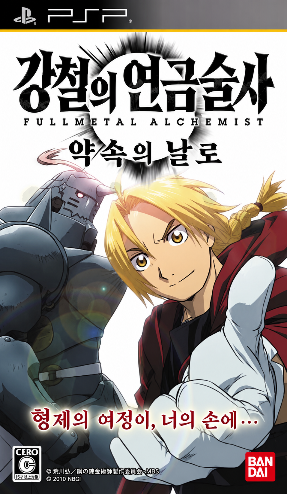

<p align="center"></p>

# 강철의 연금술사 FULLMETAL ALCHEMIST 약속의 날로 한글화

PSP용 『鋼の錬金術師 FULLMETAL ALCHEMIST 約束の日へ』(일본판, ULJS00292)의 한글 패치 제작 프로젝트입니다.

> **현재 상태: 조사·시범 번역 단계 (배포 패치 없음)**
> 한글 글꼴과 대사 재삽입이 실제 게임 화면에서 동작하는 것을 PPSSPP로 확인했고, 용어집·번역 규칙을 정한 뒤 첫 미션(M001) 시범 초벌을 마쳤습니다. 아직 내려받아 적용할 수 있는 패치는 없습니다.

## 진행 상황

| 항목 | 상태 |
|---|---|
| 데이터 구조 조사 (CPK·대사 스크립트·글꼴·EBOOT) | 완료 — [`docs/survey.md`](docs/survey.md) |
| 한글 글꼴 (Galmuri11-Bold, KS X 1001 2,350자) | 게임 화면 확인 |
| 대사 재삽입 (길이 변경·분기 재배치) | 게임 화면 확인 |
| 설치 데이터(INS000.DNS) 재암호화 | 원본 재현 확인, 게임 적용 확인 전 |
| 용어집 (정발 만화 표기 기준) | [`text/glossary.tsv`](text/glossary.tsv) 184개 |
| 번역 규칙 | [`docs/style.md`](docs/style.md) 스타일 가이드 v1.0 |
| 대사 번역 (문자열 12,644개, 약 34만 자) | 표본 78개 + M001 시범 초벌 328개, 나머지 미번역 |
| 메뉴·시스템 문구, 화자 이름, 그림 글자 | 조사 중 |

결정 사항은 [`docs/decisions.md`](docs/decisions.md), 작업 기록은 [`docs/journal.md`](docs/journal.md)에 있습니다.

## 지원 원본

정당하게 소유한 일본판 UMD 이미지만 지원합니다. 원본 이미지와 게임 데이터는 이 저장소에 없으며 배포하지 않습니다.

| 항목 | 값 |
|---|---|
| ISO 크기 | 1,528,987,648 바이트 |
| ISO SHA-256 | `158449b7eced76fb6fc3c739956ab675154bba7825d0afcea9f2d257fb15a4fe` |
| ISO MD5 | `90ff8e7765ac60bdc66d3f28ee1c3c86` |

## 구조

```
tools/   CPK·대사 스크립트·글꼴 도구, 번역 파일 적용·검사, PPSSPP 디버거 클라이언트
tests/   pytest (원본 데이터가 필요한 테스트는 work/에 추출본이 있을 때만 실행)
text/    용어집, 번역 파일 (text/ko/srt/*.json — 한국어와 원문 해시만 담음)
docs/    조사 결과, 결정 기록, 번역 규칙, 작업 기록
```

테스트: `python3 -m pytest -q tests/`

## 번역 원칙

고유명사는 한국 정발 만화를 기준으로 통일하고, 대사와 문체는 원작의 인물성과 관계를 유지하면서 자연스러운 현대 한국어로 번역합니다.

## 사용한 자료

- 한글 글꼴: [Galmuri](https://github.com/quiple/galmuri) (SIL Open Font License 1.1)

원작 『강철의 연금술사』와 게임의 권리는 각 권리자에게 있습니다. 이 프로젝트는 비공식 팬 번역입니다.
